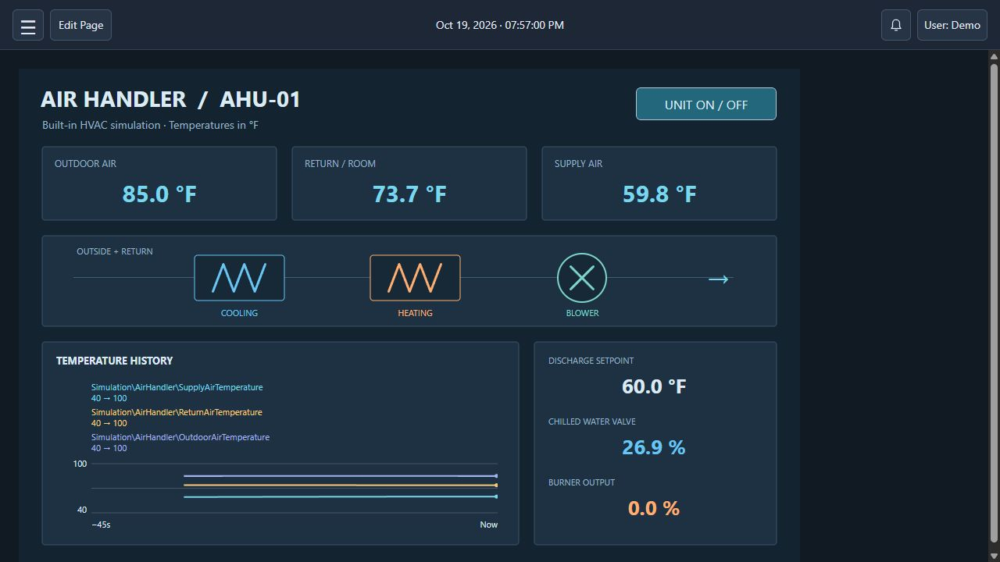
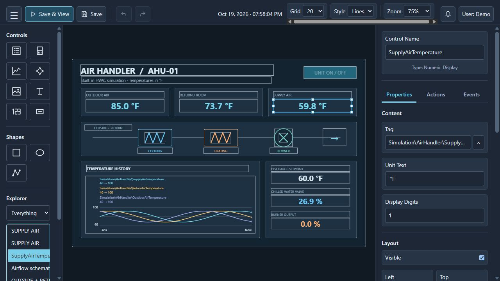
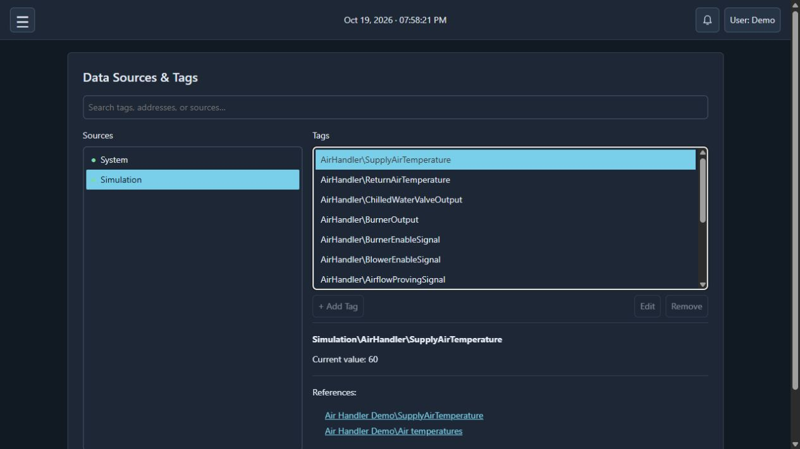

# Oops! All Buttons

A browser-based HMI for building operator screens, connecting device tags, and watching live equipment data. Built with Python and plain HTML, CSS, and JavaScript.

> **Pre-release software:** This project is still under active development and may contain bugs, incomplete features, or breaking changes. Back up your project before updating and test changes before using them with equipment. See the [safety and network warning](#safety-and-network-warning) below.

Connect to equipment through these drivers:

| Driver | Example devices or data |
| --- | --- |
| EtherNet/IP via PyComm3 | Allen-Bradley ControlLogix and CompactLogix PLCs; Ethernet-accessible SLC 500 and MicroLogix controllers through SLC mode; configured CIP objects through CIP mode. |
| BACnet/IP via BAC0 | BACnet/IP air-handler controllers, thermostats, VAV controllers, and building-automation devices. |
| Modbus TCP via PyModbus | Ethernet PLCs, remote I/O, energy meters, and variable-frequency drives with Modbus TCP enabled. |
| Modbus RTU via PyModbus | Serial/RS-485 temperature controllers, meters, drives, and remote I/O through a suitable serial adapter. |
| LightYak v1 via PySerial | Serial-connected Arduino or other devices implementing the LightYak v1 protocol, with scalar tag browsing and reads/writes. |
| MQTT via Eclipse Paho | MQTT-enabled sensors and ESP32/Arduino projects publishing supported values through a broker. |
| System | Built-in memory tags, date/time, uptime, heartbeat, and connection status; no hardware required. |
| SQLite Database | Persistent named tags stored in an app-managed SQLite file. |
| Simulation | Built-in Air Handler with temperatures, blower, heating, cooling, and writable setpoints. |
| Sheets | Calculated values derived from tags and spreadsheet formulas. |

These are protocol/device examples, not a list of hardware verified with this project. Check your device's protocol support and the testing notes below. Protocol references: [PyComm3](https://github.com/ottowayi/pycomm3), [BACnet](https://bacnet.org/about/), [Modbus](https://www.modbus.org/introduction-to-modbus), [MQTT](https://mqtt.org/).

**[Getting started guide](docs/GETTING_STARTED.md)** — from first launch to connecting a device, adding tags, and building a live page.

## Get started

### Windows portable installation

The portable release is for **64-bit Windows**. Python and the driver dependencies are included; no Python installation is needed.

1. Open **[Releases](../../releases)** and download `OopsAllButtons-<version>-windows-x64.zip` from the release assets.
2. Right-click the ZIP and choose **Extract All**. Extract the entire folder to a location you can write to; do not run the executable from inside the ZIP.
3. Open the extracted `OopsAllButtons` folder and run **`OopsAllButtons.exe`**. Keep the `files` folder beside it.
4. Your browser should open automatically. If needed, use **Launch** from the tray icon or open **http://127.0.0.1:8080**.
5. Create an administrator account and acknowledge the first-run warning, or restore an existing backup.

Your project is stored in the `data` folder beside the executable. The tray menu provides **Launch**, **Restart Server**, and **Exit**. Closing the browser does not stop the server; use **Exit** when you want to shut it down. See [Backups and updates](#backups-and-updates) before installing a newer release.

### Run from source

Use Python 3.11 or newer. From the project folder:

```sh
python -m venv .venv
# Windows:
.venv\Scripts\activate
# Linux: source .venv/bin/activate
python -m pip install -r requirements.txt
python run.py
```

On Linux, use `python3` to create the environment. The browser opens at **http://127.0.0.1:8080**. Use `--no-browser --no-tray` when running without a desktop.

Install the additional dependencies for the features you need:

| Feature | Requirements file |
| --- | --- |
| PyComm3 | `requirements-plc.txt` |
| BACnet/IP | `requirements-bacnet.txt` |
| Modbus TCP / RTU | `requirements-modbus.txt` |
| MQTT | `requirements-mqtt.txt` |
| [LightYak serial](docs/LIGHTYAK.md) | `requirements-lightyak.txt` |
| Sheet formulas | `requirements-sheet.txt` |
| DXF import | `requirements-dxf.txt` |

For example: `python -m pip install -r requirements-modbus.txt`.

For access from another computer, use `python run.py --host 0.0.0.0` and visit `http://<server-IP>:8080`. The default port is 8080. The HTTP server is Waitress; see [network and HTTPS configuration](docs/WEB_SERVER.md) for hostname aliases and a trusted HTTPS reverse proxy. `--kiosk` launches a supported browser fullscreen; `--port` changes the server port.

### Explore the examples

Fresh projects include an editable **Start Page** with getting-started instructions and three demo tags directly under `System\Memory`: `DemoTankLevel`, `DemoPumpEnabled`, and `DemoMode`. Edit or delete it like any page; restarts and updates will not recreate it. Existing projects and restored backups keep their own pages.

**Try it without a controller:** Open **Data Sources & Tags → Add Source**, choose **Simulation**, leave Air Handler selected, and save. Its tags appear under `Simulation\AirHandler`. Add controls to a page, bind them to those tags, and set `UnitEnableSignal` to `1` to start the model. Outdoor temperature, discharge setpoint, and room heat load are writable. Temperatures use °F.

## What’s included

- A visual designer with controls, shapes, groups, actions, and conditional events.
- SVG/DXF symbols, images, numeric displays, level indicators, and multitag live trends.
- PyComm3, BACnet/IP, Modbus TCP/RTU, and MQTT connections.
- System memory/time tags, persistent SQLite tags, and calculated sheets.
- Alarms with silencing, history, focused notifications, and access roles.
- Users, kiosk mode, themes, and project backup/restore.
- A built-in Air Handler simulation for learning and testing.

## Testing status and continued work

This is pre-release software, and testing is still limited:

- **Modbus RTU:** untested with physical adapters and devices. Automated simulations have been checked, but real hardware operation is unverified.
- **LightYak v1:** tested with simulated serial devices; physical hardware testing is still needed.
- **BACnet/IP:** mostly untested; broader device and network testing is needed.
- **Modbus TCP:** lightly tested; more device compatibility and reliability testing is needed.

Planned additions include **Modbus device profiles** to simplify configuration, **more built-in symbols** for designing pages, and **built-in help** so instructions are available directly inside the app.

## Screenshots

A demonstration page built with ordinary controls and the built-in HVAC simulation. The diagram is an example you can create in the designer; it is not an automatically generated screen.

### Live view



### Designer



### Data Sources & Tags



## Backups and updates

Use **Administration → Backup/Restore** to download a backup. Restores take effect after restarting the server.

For a portable update, exit the old server, extract the new release into a new folder, and copy your `data` folder beside the new executable. If a restore is pending, also copy `data.restore.oab-backup` (or legacy `data.restore.zip`). Keep the old installation until you have verified the update.

See [BUILDING.md](BUILDING.md) for portable builds and releases, and [DEVELOPING.md](DEVELOPING.md) for development notes.

## Safety and network warning

This software can write to PLCs and controllers operating dangerous or moving equipment. Incorrect commands can cause serious injury, death, or property damage. Use only if qualified and authorized, test safely, and keep emergency stops and safety interlocks independent of this HMI. **It is not a safety system.**

Keep the server and devices on a **trusted, access-controlled network**. Do not expose them directly to the internet. Use a securely configured VPN for remote access. The app serves HTTP.

You are responsible for validating the system and operating it safely. This software is provided **“as is,” without warranties**. To the extent permitted by applicable law, the developer assumes no responsibility or liability for injury, damage, loss, or other consequences of its use.

## License

The project's original code is available under the [MIT License](LICENSE). Bundled libraries retain their own licenses; see [Third-party notices](THIRD_PARTY_NOTICES.md) and the [portable license review](docs/LICENSE_REVIEW.md).

## Acknowledgments

I take no credit for the coding work in this project—it was coded with ChatGPT Codex.

Thank you to all the developers who shared their knowledge, code, tools, and documentation. Your contributions made this project possible.

Application documents use `.oab-backup` for backups, `.oab-page` for page exports, and `.oab-sheet` for sheets. Older JSON exports and sheet files remain supported.

Fresh installations can require sign-in or run without sign-in. Without sign-in, everyone who can reach the server has full administrator access, and activity is recorded as **User**. Change this under **Administration → Site Configuration → Server Settings**. Use Save or Revert for pending changes; Save asks before a port restart or sign-in change. Enabling sign-in creates an administrator if needed and signs out open sessions; existing accounts and project data are retained.
